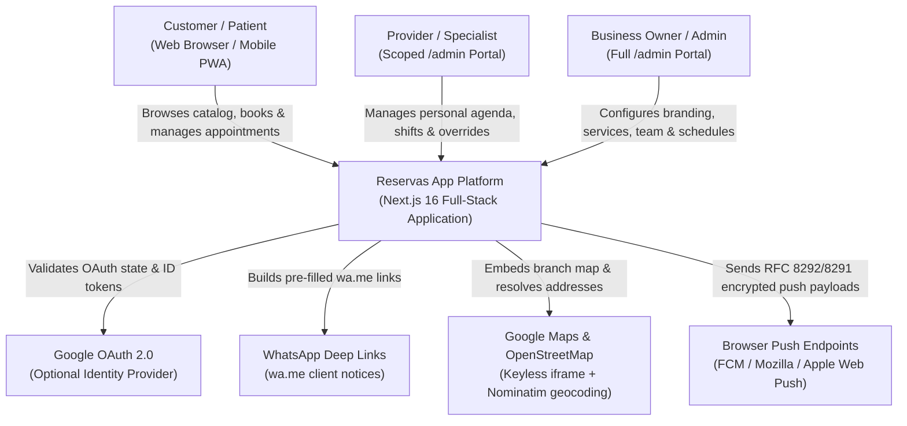
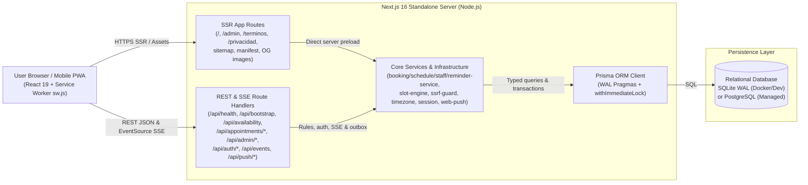
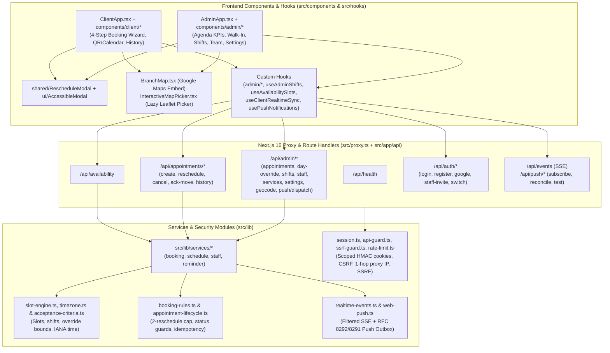

# System Architecture (C4 Models & Engineering Decisions)

This document outlines the software architecture of **Reservas App**, a multi-staff appointment booking and schedule management platform modeled with the **C4** approach.

---

## 1. Level 1: System Context Diagram

---

## 2. Level 2: Container Diagram

---

## 3. Level 3: Component & Module Map

---

## 4. Level 4: Deployment Profiles

### Profile A: Containerized Single-Node (Oracle Cloud E2.1.Micro 1 GB AMD64 + GHCR + SQLite WAL)
- Multi-stage `Dockerfile` (`node:24-alpine` + `linux/amd64` + Next.js `output: "standalone"` + `NODE_OPTIONS="--max-old-space-size=384"`).
- GitHub Actions (`docker-publish.yml`) runs strictly after [`ci.yml`](../.github/workflows/ci.yml) passes and pushes to `ghcr.io/cristianarando/reservation-microsystem`.
- `docker-compose.yml` binds `127.0.0.1:3000:3000` (fronted by direct Nginx/Caddy with `TRUSTED_PROXY_HOPS=1`), limits memory (`mem_limit: 650m`, `memswap_limit: 900m`), probes `GET /api/health`, and mounts `./data:/app/data` for SQLite WAL + rotating backups (`docker-entrypoint.sh` + `prisma migrate deploy`).
- `src/instrumentation.ts` starts the 5-minute Web Push retry/reclaim and 24h/2h reminder outbox worker on Node runtime boot.

### Profile B: Serverless / Managed Cloud (Vercel + Managed PostgreSQL)
- Switch `prisma/schema.prisma` datasource to `"postgresql"` for Neon/Supabase/RDS clusters.
- Note: in-memory SSE subscribers (`realtime-events.ts`) and in-memory rate-limit buckets (`rate-limit.ts`) are scoped per Node instance and should be backed by a shared pub/sub + Redis store if horizontally scaled across multiple instances.

---

## 5. Key Architectural & Security Decisions

1. **Decoupled Pure Business Logic (`src/lib`):** `slot-engine.ts`, `booking-rules.ts`, `acceptance-criteria.ts`, and `input-validators.ts` have zero HTTP/React dependencies, enabling sub-second deterministic unit verification.
2. **Defense-in-Depth RBAC & Session Revocation:** Signed `HttpOnly` `SameSite=Lax` HMAC-SHA256 cookies verified via `timingSafeEqual`, paired with `User.sessionVersion` validation so password changes, privilege upgrades, or staff invite acceptances immediately invalidate prior sessions.
3. **Server-Side SSE Isolation:** `filterRealtimeEventForSubscriber()` strips or suppresses payloads on the server before writing to the SSE stream so unauthenticated visitors and non-owning customers/providers never receive cross-user PII.
4. **Transactional Outbox for Native Web Push:** Notifications and `PushDelivery` records are persisted inside the same Prisma transaction as the booking/cancellation/override mutation, avoiding lost pushes on transient endpoint failures while keeping lock-screen titles/bodies generic.
