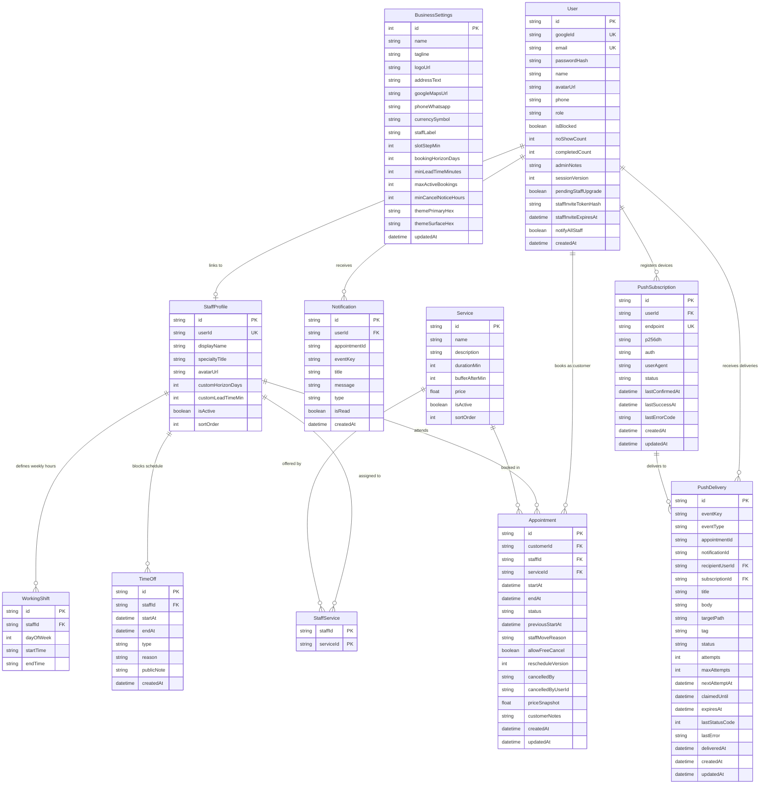

# Database Architecture & Entity Dictionary

This document describes the relational data model, constraints, composite indexes, and migration options implemented with **Prisma ORM** in [`prisma/schema.prisma`](../prisma/schema.prisma).

---

## 1. Entity-Relationship Diagram

---

## 2. Entity Dictionary

### `BusinessSettings` (White-Label Business Configuration)
Singleton configuration record (`id = 1`) holding branding, location, and booking policy defaults.

| Column | Type | Constraints / Default | Description |
| :--- | :--- | :--- | :--- |
| `id` | `Int` | PK, `@default(1)` | Singleton identifier |
| `name` | `String` | Default: `"Mi Negocio"` | Public business name |
| `tagline` | `String` | Default: `"Reserva tu cita en segundos"` | Short subtitle/description |
| `logoUrl` | `String?` | Optional | Logo URL or sanitized data URL |
| `addressText` | `String` | Default: `"Av. Principal 123, Bolivia"` | Street address shown to visitors |
| `googleMapsUrl` | `String` | Default: `"https://maps.google.com"` | Google Maps link / pin URL |
| `phoneWhatsapp` | `String` | Default: `"+59170000000"` | Official WhatsApp contact number |
| `currencySymbol` | `String` | Default: `"Bs"` | Currency symbol (`Bs`, `$`, `€`, etc.) |
| `staffLabel` | `String` | Default: `"Especialista"` | Dynamic role terminology ("Doctor(a)", "Barbero", etc.) |
| `slotStepMin` | `Int` | Default: `30` | Candidate slot grid interval in minutes |
| `bookingHorizonDays` | `Int` | Default: `7` | Default future booking horizon in days |
| `minLeadTimeMinutes` | `Int` | Default: `30` | Minimum advance lead time before slot start |
| `maxActiveBookings` | `Int` | Default: `2` | Anti-hoarding cap on active upcoming bookings |
| `minCancelNoticeHours` | `Int` | Default: `6` | Minimum advance notice for penalty-free customer cancel |
| `themePrimaryHex` | `String` | Default: `"#1F1F23"` | Primary brand accent color |
| `themeSurfaceHex` | `String` | Default: `"#9FA0A6"` | Secondary surface accent color |
| `updatedAt` | `DateTime` | `@updatedAt` | Last configuration update timestamp |

### `User` (Identity, RBAC, Session Revocation & Invitations)
Represents all system actors (`CUSTOMER`, `PROVIDER`, `ADMIN`).

| Column | Type | Constraints / Default | Description |
| :--- | :--- | :--- | :--- |
| `id` | `String` | PK (`cuid()`) | Unique user ID |
| `googleId` | `String?` | Unique | Verified Google OAuth `sub` identifier |
| `email` | `String` | Unique, Required | Normalized lowercase email address |
| `passwordHash` | `String?` | Optional | Bcrypt password hash (null for Google-only accounts) |
| `name` | `String` | Required | Full name |
| `avatarUrl` | `String?` | Optional | Profile image URL |
| `phone` | `String?` | Optional | Contact phone number |
| `role` | `String` | Default: `"CUSTOMER"` | `"CUSTOMER" \| "PROVIDER" \| "ADMIN"` |
| `isBlocked` | `Boolean` | Default: `false` | Anti-troll lock triggered on 2nd `NO_SHOW` |
| `noShowCount` | `Int` | Default: `0` | Current unexcused absence strike count |
| `completedCount` | `Int` | Default: `0` | Completed appointment counter |
| `adminNotes` | `String?` | Optional | Internal admin-only customer notes |
| `sessionVersion` | `Int` | Default: `1` | Incremented on password/role changes to revoke old cookies |
| `pendingStaffUpgrade` | `Boolean` | Default: `false` | True while an invited user has not verified staff onboarding |
| `staffInviteTokenHash` | `String?` | Optional | SHA-256 hash of single-use staff invitation token |
| `staffInviteExpiresAt` | `DateTime?` | Optional | Expiration timestamp for pending staff invite |
| `notifyAllStaff` | `Boolean` | Default: `false` | Admin preference for receiving alerts across all staff agendas |
| `createdAt` | `DateTime` | `@default(now())` | Account creation timestamp |

### `StaffProfile` & `StaffService`
- **`StaffProfile`**: `id`, `userId` (`String?`, unique FK to `User`), `displayName`, `specialtyTitle` (default `"Especialista"`), `avatarUrl`, `customHorizonDays`, `customLeadTimeMin`, `isActive` (default `true`), `sortOrder` (default `0`).
- **`StaffService`**: Join table with composite PK `@@id([staffId, serviceId])` and `onDelete: Cascade` to both `StaffProfile` and `Service`.

### `Service`
`id`, `name`, `description`, `durationMin` (default `30`), `bufferAfterMin` (default `0`), `price` (default `25.0`), `isActive` (default `true`), `sortOrder` (default `0`).

### `WorkingShift`
Weekly recurring shift templates per specialist: `id`, `staffId` (FK, cascade delete), `dayOfWeek` (`0..6`), `startTime` (`"HH:mm"`), `endTime` (`"HH:mm"`).

### `TimeOff`
Explicit unavailability overrides and vacation ranges: `id`, `staffId` (FK, cascade delete), `startAt`, `endAt`, `type` (default `"CUSTOM_BLOCK"`, supports `"LATE_START" | "EARLY_LEAVE" | "FULL_DAY_OFF" | "CUSTOM_BLOCK" | "VACATION"`), `reason` (internal staff note), `publicNote` (public-approved notice returned to visitors), `createdAt`.

### `Appointment`
Core reservation lifecycle table:
- Relations: `customerId` (FK `User`), `staffId` (FK `StaffProfile`), `serviceId` (FK `Service`).
- Timing & Pricing: `startAt`, `endAt`, `priceSnapshot`, `customerNotes`.
- Lifecycle & Concurrency:
  - `status` (default `"CONFIRMED"`): `"CONFIRMED" | "RESCHEDULED_BY_STAFF" | "COMPLETED" | "CANCELLED" | "NO_SHOW" | "NO_SHOW_ARCHIVED"`.
  - `previousStartAt`, `staffMoveReason`, `allowFreeCancel`, `rescheduleVersion` (monotonic counter).
  - `cancelledBy` (`"STAFF" | "CUSTOMER" | "ADMIN"`), `cancelledByUserId`.

### `Notification`
In-app alert feed: `id`, `userId` (FK `User`, cascade), `appointmentId`, `eventKey` (idempotency guard against retries), `title`, `message`, `type` (`"APPOINTMENT_MOVED" | "APPOINTMENT_CANCELLED" | "APPOINTMENT_CANCELLED_BY_CUSTOMER" | "NEW_APPOINTMENT" | "REMINDER"`), `isRead` (default `false`), `createdAt`.

### `PushSubscription` & `PushDelivery` (Web Push Outbox)
- **`PushSubscription`**: `id`, `userId` (FK `User`, cascade), `endpoint` (Unique), `p256dh`, `auth`, `userAgent`, `status` (`"ACTIVE" | "EXPIRED" | "REVOKED" | "UNSUBSCRIBED"`), `lastConfirmedAt`, `lastSuccessAt`, `lastErrorCode`, `createdAt`, `updatedAt`.
- **`PushDelivery`**: Transactional push outbox row per `(eventKey, recipientUserId, subscriptionId)` storing `eventType`, `appointmentId`, `notificationId`, lock-screen safe `title`/`body`, `targetPath`, `tag`, `status` (`"PENDING" | "PROCESSING" | "DELIVERED" | "FAILED_PERMANENT" | "EXPIRED" | "SKIPPED"`), `attempts`, `maxAttempts` (`5`), `nextAttemptAt`, `claimedUntil` (worker lease), `expiresAt`, `lastStatusCode`, `lastError`, `deliveredAt`.

---

## 3. Indexes & Uniqueness Constraints

Defined directly in `prisma/schema.prisma`:
1. `WorkingShift`: `@@index([staffId, dayOfWeek])`
2. `TimeOff`: `@@index([staffId, startAt, endAt])`
3. `Appointment`: `@@index([staffId, startAt, endAt])` and `@@index([customerId, status, startAt])`
4. `Notification`: `@@index([userId, isRead])` and `@@index([eventKey])`
5. `PushSubscription`: `endpoint @unique` and `@@index([userId, status])`
6. `PushDelivery`: `@@unique([eventKey, recipientUserId, subscriptionId])`, `@@index([status, nextAttemptAt])`, and `@@index([recipientUserId, status])`

---

## 4. Database Engine Notes (SQLite WAL vs. PostgreSQL)

- **Local & Single-Node Docker (`sqlite`)**: [`src/lib/prisma.ts`](../src/lib/prisma.ts) applies `PRAGMA journal_mode = WAL`, `PRAGMA busy_timeout = 5000`, `PRAGMA synchronous = NORMAL`, and `PRAGMA foreign_keys = ON` once per process for concurrent read/write safety.
- **Managed PostgreSQL (Neon / Supabase / RDS)**: Change `provider = "sqlite"` to `provider = "postgresql"` in [`prisma/schema.prisma`](../prisma/schema.prisma), set `DATABASE_URL`, and run `pnpm prisma db push`.
