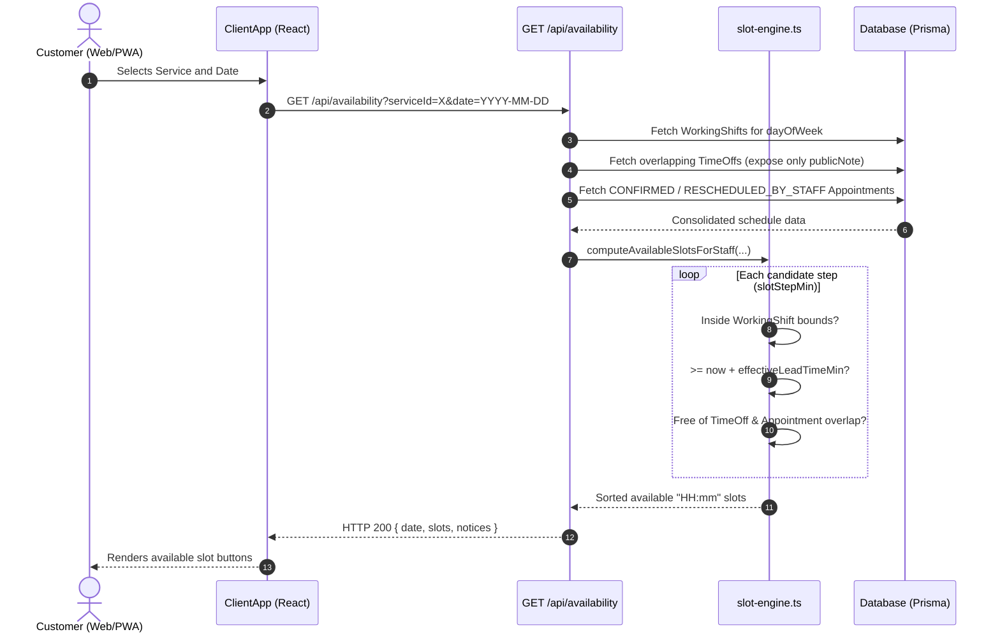
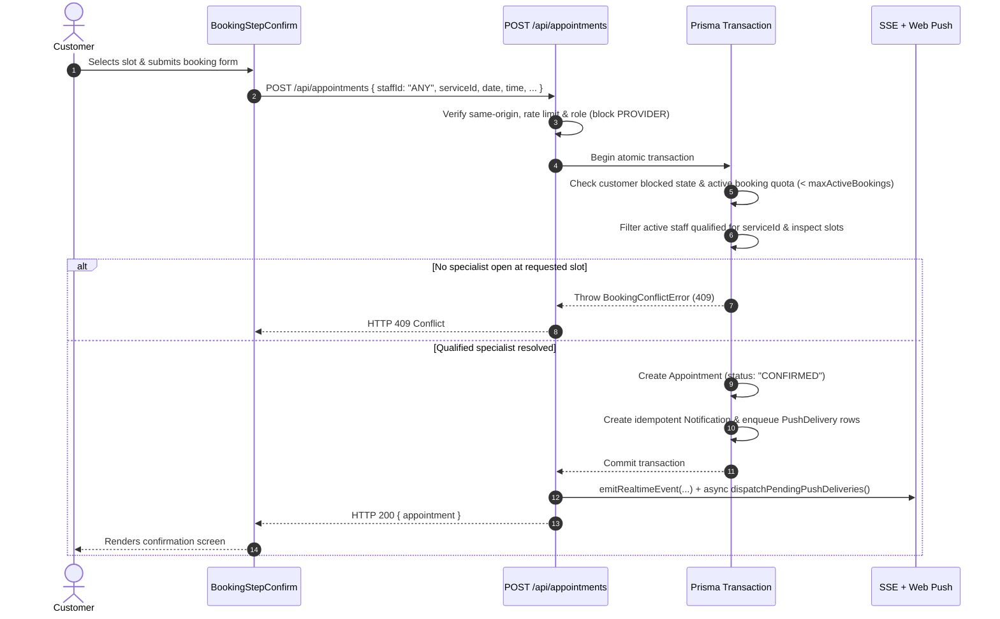
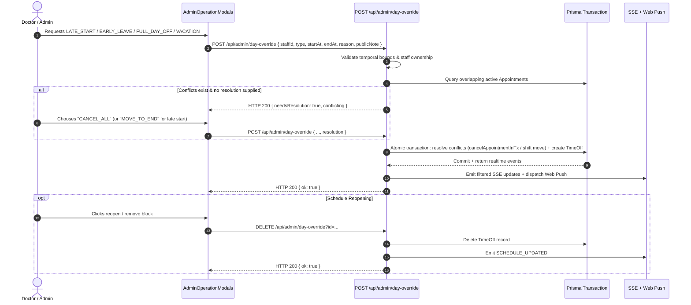
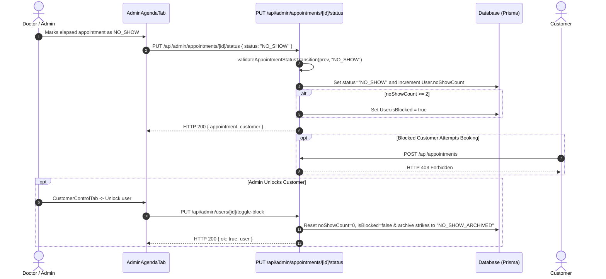

# System Sequence Diagrams & Operational Flows

This document details the core transactional and operational workflows implemented in the application.

---

## 1. Availability Calculation Flow (`Slot Engine`)

Evaluates weekly shifts, active `TimeOff` overrides, existing appointments, and lead time rules to return valid non-colliding slots.

---

## 2. Atomic Booking Flow with Auto-Assignment (`staffId="ANY"`)

---

## 3. Schedule Override & Conflict Resolution Flow (`/api/admin/day-override`)

---

## 4. Appointment Cancellation & 2-Strike No-Show Flow

### Unified Cancellation (`cancelAppointmentInTx`)
Shared across `POST /api/appointments/[id]/cancel`, `PUT /api/admin/appointments/[id]/status`, and `POST /api/admin/day-override`:
- Sets `status = "CANCELLED"`, `cancelledBy = "STAFF" | "CUSTOMER"`, and `cancelledByUserId`.
- Idempotent if already `CANCELLED` (prevents duplicate `Notification` or `PushDelivery` records).
- Staff cancellations notify the customer; customer cancellations mark customer unread notices read and notify the assigned staff member (plus `notifyAllStaff` admins).

### 2-Strike No-Show Protection

---

## 5. 1-Click Rescheduling, Walk-In/Overbooking & 24h/2h Reminders
- **1-Click Rescheduling (`POST /api/appointments/[id]/reschedule`)**: Executed inside `withImmediateLock`; customers can self-reschedule up to **2 times** (`customerRescheduleCount < 2`) respecting `minCancelNoticeHours` (or anytime when `allowFreeCancel = true`), whereas `ADMIN`/`PROVIDER` staff can move appointments freely with optional `allowOverbooking`. Rescheduling clears `reminder24hSentAt` and `reminder2hSentAt` so reminders match the updated timestamp.
- **Walk-In Reception (`POST /api/admin/appointments`)**: Lets `ADMIN` or scoped `PROVIDER` book walk-in customers quickly (creating/reusing a `@local.invalid` customer record when email is omitted) and optionally bypass slot occupancy with `isOverbooking = true`.
- **Automated Reminder Worker (`src/lib/services/reminder-service.ts`)**: Polls `[23h, 25h]` (`reminder24hSentAt`) and `[90m, 150m]` (`reminder2hSentAt`) windows every 5 minutes inside `startPushDispatcherWorker`, claiming rows atomically to avoid duplicate in-app or Web Push reminders across restarts.
